# CampusVoiceBox — Admin Manual

**Our Lady of Lourdes College Foundation · Daet, Camarines Norte**

This manual is for the administrators who run CampusVoiceBox: the people who review what students send in, hand concerns to the right college, and keep the platform's accounts in order.

If you are a student, see the [Student Manual](STUDENT-MANUAL.md) instead. If you are a developer looking for how the code works, see the [Code Walkthrough](CODE-WALKTHROUGH.md).

---

## Contents

1. [Overview](#1-overview)
2. [Getting started](#2-getting-started)
   - 2.1 [Logging in](#21-logging-in)
   - 2.2 [The admin panel layout](#22-the-admin-panel-layout)
   - 2.3 [Logging out](#23-logging-out)
3. [The vocabulary: types, statuses, categories, departments, roles](#3-the-vocabulary)
   - 3.1 [Submission types](#31-submission-types)
   - 3.2 [The status lifecycle](#32-the-status-lifecycle)
   - 3.3 [Categories](#33-categories)
   - 3.4 [Departments](#34-departments)
   - 3.5 [Roles and permissions](#35-roles-and-permissions)
4. [The Dashboard](#4-the-dashboard)
5. [Reviewing new submissions (Pending Approval)](#5-reviewing-new-submissions)
   - 5.1 [The Pending Approval queue](#51-the-pending-approval-queue)
   - 5.2 [The review dialog](#52-the-review-dialog)
   - 5.3 [How to approve a submission](#53-how-to-approve-a-submission)
   - 5.4 [How to reject a submission](#54-how-to-reject-a-submission)
   - 5.5 [Putting a submission on hold (Under Review)](#55-putting-a-submission-on-hold)
   - 5.6 [Anonymous submissions](#56-anonymous-submissions)
   - 5.7 [Internal notes](#57-internal-notes)
6. [Handling open work (Open Work)](#6-handling-open-work)
   - 6.1 [The Open Work queue](#61-the-open-work-queue)
   - 6.2 [How to assign a concern to a department](#62-how-to-assign-a-concern-to-a-department)
   - 6.3 [How to resolve a concern](#63-how-to-resolve-a-concern)
   - 6.4 [Resolving a plain suggestion](#64-resolving-a-plain-suggestion)
   - 6.5 [Reassigning, reopening and undoing](#65-reassigning-reopening-and-undoing)
7. [All Submissions: searching, filtering and exporting](#7-all-submissions)
8. [Managing users](#8-managing-users)
   - 8.1 [The Users list](#81-the-users-list)
   - 8.2 [A user's profile page](#82-a-users-profile-page)
   - 8.3 [Editing an account](#83-editing-an-account)
   - 8.4 [Suspending and reactivating](#84-suspending-and-reactivating)
   - 8.5 [Changing a role](#85-changing-a-role)
   - 8.6 [Deleting an account](#86-deleting-an-account)
   - 8.7 [Forgotten passwords](#87-forgotten-passwords)
   - 8.8 [Privacy requests](#88-privacy-requests)
9. [Insights](#9-insights)
   - 9.1 [Analytics](#91-analytics)
   - 9.2 [Departments](#92-departments)
   - 9.3 [Reports & Exports](#93-reports--exports)
10. [Notifications](#10-notifications)
11. [Activity Logs](#11-activity-logs)
12. [System](#12-system)
13. [Your own profile](#13-your-own-profile)
14. [Frequently asked questions](#14-frequently-asked-questions)
15. [Important notes about this build](#15-important-notes-about-this-build)

---

## 1. Overview

CampusVoiceBox has **one account system and two faces**. Students see the public board; administrators see the admin panel. There is no separate admin login — everybody signs in on the same page, and the **role** on the account decides where they land.

As an administrator your job has three parts:

1. **Review** every new submission and decide whether it goes on the board.
2. **Route** approved requests, concerns, complaints and reports to the college or department that can act on them, and record what was done.
3. **Keep the platform in order** — accounts, roles, and the record of what administrators have done.

Everything you do that changes a student's submission or account **notifies the student** and is **written to the activity log**. Nothing is silent.

---

## 2. Getting started

### 2.1 Logging in

1. Open the site (during development, `http://localhost:3000`) and click **Log in**.
2. Enter your administrator email and password and click **Log in**.
3. Because your account has the admin role, you land on the **Admin Dashboard** rather than the student board.

To change your password, use the **Password** panel on your own profile ([section 13](#13-your-own-profile)). If you forget it, use **Forgot password?** on the log-in page ([8.7](#87-forgotten-passwords)).

> **Setting up a new installation.** The administrator is the default account, created by the server from the email and password set when it was installed (`ADMIN_EMAIL` and `ADMIN_PASSWORD` — see GUIDE.md). The sign-up page is for students and users only and never makes an administrator; only an administrator can promote an account — see [8.5](#85-changing-a-role) and [section 15](#15-important-notes-about-this-build).

You can use the student side too — read the board, post and vote. Click **View site** in the top bar to open it, and **Admin panel** in your profile menu there to come back.

### 2.2 The admin panel layout

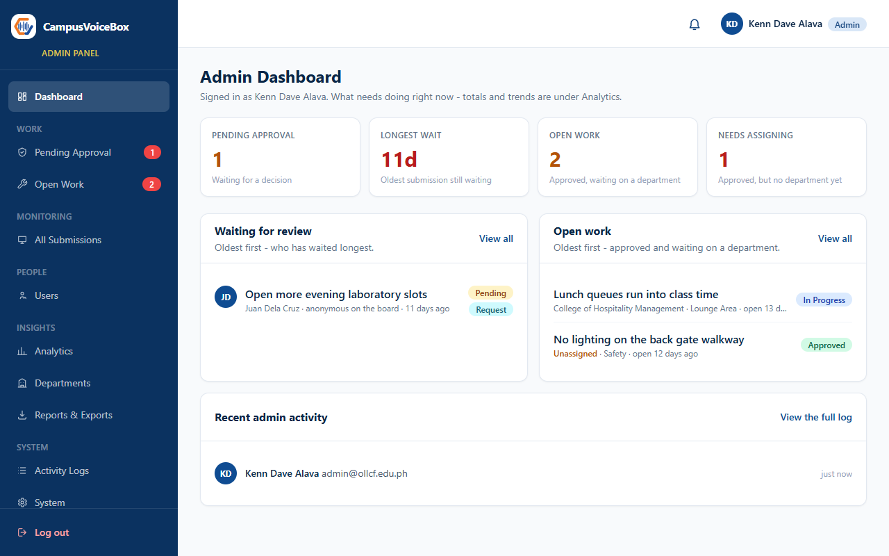

**The sidebar** (left) is the same on every admin page. It is grouped into:

| Group | Pages | What they are for |
|---|---|---|
| — | **Dashboard** | What needs doing right now. |
| **Work** | **Pending Approval**, **Open Work** | The two live queues. A red badge shows how many items are waiting in each; no badge means the queue is clear. |
| **Monitoring** | **All Submissions** | Every submission ever made, for looking things up. |
| **People** | **Users**, **Privacy Requests** | Every account; and what people asked about their own information. A red badge on Privacy Requests counts the open requests you can handle. |
| **Insights** | **Analytics**, **Departments**, **Reports & Exports** | Totals, trends, workload, and CSV downloads. |
| **System** | **Activity Logs**, **System** | The audit trail, and the platform's vocabulary. |
| — | **Log out** | At the bottom. |

At the foot of every admin page are the **Privacy Policy**, **Terms & Conditions**, **Cookie Policy** and **Cookie settings** links.

**The top bar** has **View site** on the left — the student side of the platform ([2.1](#21-logging-in)) — and two things on the right:

- **The bell** — your notifications. A red number on it is the unread count. See [section 10](#10-notifications).
- **Your name and avatar** — click it to open your own profile page ([section 13](#13-your-own-profile)).

On a phone or a narrow window the sidebar is hidden; a **☰ menu button** appears in the top-left corner to open it.

### 2.3 Logging out

Click **Log out** at the bottom of the sidebar, then **Yes, log out** in the confirmation.

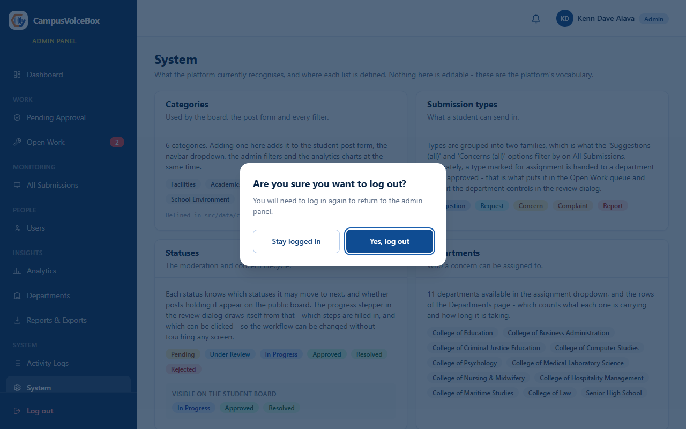

---

## 3. The vocabulary

Every screen in the panel is built from five short lists. Knowing them makes the rest of the panel obvious. All five are shown, read-only, on the **System** page.

### 3.1 Submission types

A student picks one of five types when posting. They fall into two **families**, and — separately — some of them **need a department**.

| Type | Family | Needs a department? | What it is |
|---|---|---|---|
| **Suggestion** | Suggestion | No | An idea. Once approved it sits on the board for votes; nobody is assigned to "fix" it. |
| **Request** | Suggestion | **Yes** | A specific ask. Approved, then handed to a department. |
| **Concern** | Concern ("Voice Out") | **Yes** | Something bothering the student. Approved, then handed to a department. |
| **Complaint** | Concern ("Voice Out") | **Yes** | Something that went wrong. Same path as a concern. |
| **Report** | Concern ("Voice Out") | **Yes** | A hazard or incident. Same path as a concern. |

The **family** is what the *Suggestions (all)* / *Concerns (all)* filter on All Submissions uses. **Needs a department** is what puts an approved item into the Open Work queue and gives it the assignment controls in the review dialog.

### 3.2 The status lifecycle

```
                       student posts
                             │
                             ▼
                      ┌─────────────┐
                      │   PENDING   │──── Approve / Reject can also be
                      └──────┬──────┘     done straight from here
                             │ Mark as under review
                             ▼
                     ┌──────────────┐
         ┌─────────▶ │ UNDER REVIEW │ ◀─────────┐
         │           └──────┬───────┘           │
         │        Approve   │   Reject          │
         │       ┌──────────┴──────────┐        │
         │       ▼                     ▼        │
  Send   │ ┌───────────┐         ┌───────────┐  │  Send back
  back   └─│ APPROVED  │         │ REJECTED  │──┘  to review
  to       │ on board  │         │ off board │     (reconsider)
  review   └─────┬─────┘         └───────────┘
                 │ Assign to department
                 │ (Request / Concern / Complaint / Report)
                 ▼
          ┌─────────────┐
          │ IN PROGRESS │ ◀────────┐
          │  on board   │          │ Reopen
          └──────┬──────┘          │
                 │ Mark resolved   │
                 ▼                 │
          ┌─────────────┐          │
          │  RESOLVED   │──────────┘
          │  on board   │
          └─────────────┘
```

Approved can also go **straight to Resolved** — that is the path for a plain suggestion (which is never assigned) and for *Resolve without assigning*.

| Status | Visible to students? | What it means | Where you can move it |
|---|---|---|---|
| **Pending** | No | Just submitted. Waiting for a decision. | Under Review · Approved · Rejected |
| **Under Review** | No | On hold — an admin is looking at it. Tells other admins it is being handled. | Approved · Rejected |
| **Approved** | **Yes** | Published. A plain suggestion usually stops here. Anything that needs a department is now in Open Work waiting to be assigned. | In Progress (by assigning) · Resolved · back to Under Review |
| **In Progress** | **Yes** | A department is working on it. | Resolved |
| **Resolved** | **Yes** | Done. The student was sent a summary of what was done. | In Progress (reopen) |
| **Rejected** | No | Not published. The student was told the reason. | Under Review (reconsider) |

The review dialog only ever offers the moves in the last column, so you cannot make an illegal move by accident.

### 3.3 Categories

Six fixed areas, chosen by the student when posting and used by every filter and chart: **Facilities**, **Academics**, **Safety**, **Lounge Area**, **Organization**, **School Environment**.

### 3.4 Departments

The eleven owners a request, concern, complaint or report can be handed to — the academic colleges plus Senior High School:

College of Education · College of Business Administration · College of Criminal Justice Education · College of Computer Studies · College of Psychology · College of Medical Laboratory Science · College of Nursing & Midwifery · College of Hospitality Management · College of Maritime Studies · College of Law · Senior High School

> A concern with no academic owner — a broken walkway light, a Wi-Fi outage — has no department on this list that fits. Such items stay **Unassigned**, which the Dashboard, the Open Work queue and the Departments page all count and flag rather than hide. Use **Resolve without assigning** ([6.5](#65-reassigning-reopening-and-undoing)) once it has been dealt with through other channels.

### 3.5 Roles and permissions

| Role | Lands on | Can |
|---|---|---|
| **Admin** | Admin Dashboard | Everything: review and route submissions, see who posted anonymously, manage users and roles, view analytics and the audit log, handle privacy requests. |
| **Student** | The board | Post and vote. An account created with a Student ID. |
| **User** | The board | Post and vote. An account created *without* a Student ID — staff or visitors. Kept separate so reports can tell them apart. |

There is one admin role and it holds every permission. What keeps it in check are the **self-checks**: an admin can never change their own role, suspend themself, or delete themself.

---

## 4. The Dashboard

The Dashboard answers one question: *what needs doing right now?* Totals and trends are under Analytics.


**The four cards** each open the queue that clears them. They read **green at zero** because on this page zero is the goal:

| Card | Meaning | Colour |
|---|---|---|
| **Pending Approval** | Submissions waiting for a decision. | Orange while any are waiting. |
| **Longest Wait** | How many days the oldest waiting submission has sat there. | Orange; **red from 7 days**. |
| **Open Work** | Approved items that need a department — assigned or not. | Orange while any are open. |
| **Needs Assigning** | Approved items with **no department yet**. | **Red** while any exist — these have no owner. |

**Waiting for review** lists the front of the Pending Approval queue, oldest first, with who sent it and how long ago. Click a row to open its review dialog.

**Open work** lists the front of the Open Work queue, oldest first, showing which department has it — or **Unassigned** in red. Click a row to open it.

**Recent admin activity** shows the last six entries of the audit log, with a link to the full log.

---

## 5. Reviewing new submissions

### 5.1 The Pending Approval queue

Sidebar → **Work → Pending Approval**.

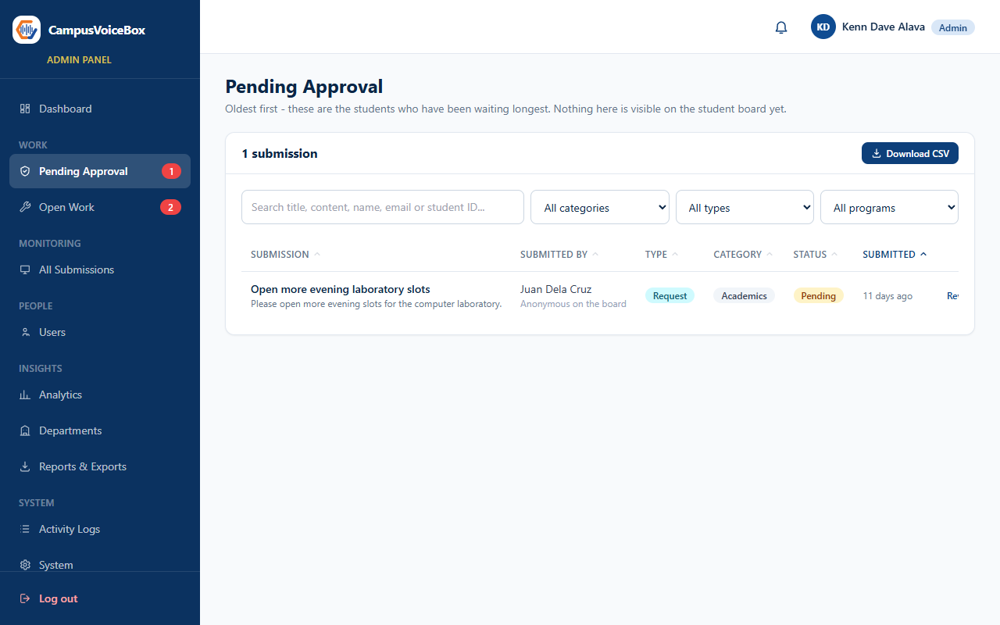

This is every submission that is *Pending* or *Under Review* — nothing here is visible on the student board yet. It is sorted **oldest first**, so the student who has waited longest is at the top.

Each row shows the title, who submitted it (with *Anonymous on the board* where relevant), the type, category, status and age. Click a row — or the **Review →** link at its end — to open the review dialog.

Use the search box and dropdowns above the table to narrow it down, and **Download CSV** to take the current view out as a spreadsheet.

### 5.2 The review dialog

Everything you do to a submission happens in this one dialog. It has five sections, top to bottom:

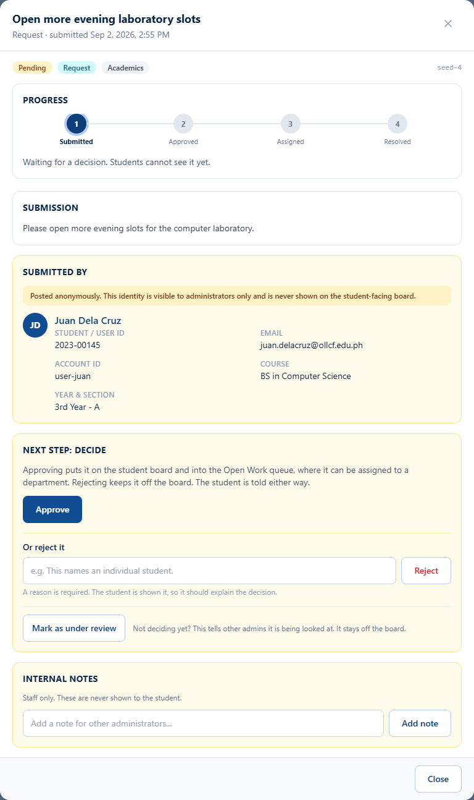

| Section | What it shows |
|---|---|
| **Header** | The title, type and submission time. The pills underneath give status, type and category; the number on the right (e.g. `12`) is its ID, useful when searching. |
| **Progress** | Where the submission is on its path, and a one-line caption saying what that means. The path has four steps for anything that needs a department (Submitted → Approved → Assigned → Resolved) and three for a plain suggestion (Submitted → Approved → Resolved). After you press a button, the caption is replaced by a sentence saying what just happened and what to do next. |
| **Submission** | The student's message and any attached photos or PDFs. Click one to open it full size in a new tab. |
| **Submitted by** (amber) | Who sent it — name, student ID, email, course, year and section — with a link to their account. Amber means *staff only*. |
| **Next step** (amber) | The one thing this submission needs now. Its contents change with the status — see the sections that follow. Any error lands directly under it. |
| **Internal notes** (amber) | Notes for other administrators. Never shown to the student. |

Close the dialog with the **×**, the **Close** button, or the Esc key. Nothing is lost by closing — every action is saved the moment you press its button.

### 5.3 How to approve a submission

1. Open the submission from Pending Approval (or the Dashboard).
2. Read the message and the *Submitted by* section. Check it follows the rules — no naming of individuals, no abuse, not a duplicate of something already on the board.
3. In **Next step: decide**, click **Approve**.

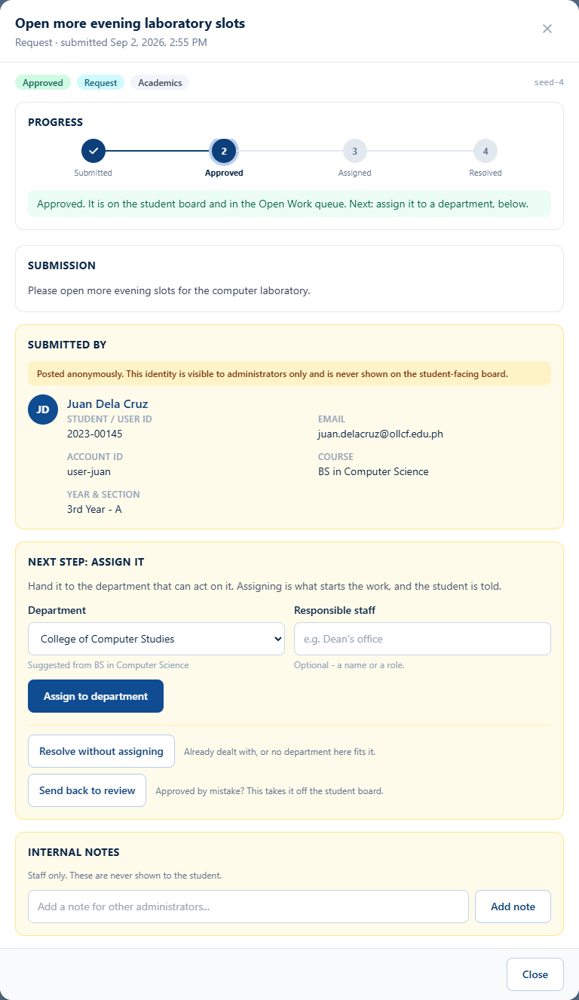

What happens:

- The submission goes on the **student board** immediately.
- The student is sent a *Post approved* notification.
- An *Approved submission* entry is written to the activity log.
- If it is a request, concern, complaint or report, it also appears in the **Open Work** queue, waiting to be assigned. The caption says so: *"Next: assign it to a department, below."* You can do that straight away — the dialog now shows the assign form ([6.2](#62-how-to-assign-a-concern-to-a-department)) — or come back to it later from Open Work.

### 5.4 How to reject a submission

1. Open the submission.
2. In **Next step: decide**, type a reason into the **Or reject it** box. A reason is **required** — the student is shown it, so it should explain the decision, e.g. *"This names an individual student"* or *"Already raised — see 'More power outlets in the library'"*.
3. Click **Reject**.

What happens:

- The submission stays **off the board**.
- The student is sent a *Post rejected* notification carrying your reason, and the reason is shown under the post on their dashboard.
- A *Rejected submission* entry is written to the log.

If you press **Reject** with the box empty you get *"Please give a reason…"* and nothing is sent. A rejection is not final — see [6.5](#65-reassigning-reopening-and-undoing) for sending it back to review.

### 5.5 Putting a submission on hold

Not ready to decide? Click **Mark as under review**. The status becomes *Under Review*, the submission stays off the board, and other administrators can see it is being looked at. The student is told its status changed. From here the only moves are **Approve** or **Reject**.

### 5.6 Anonymous submissions

Anonymous posting promises the student that their name will not appear **on the board** — not that nobody is accountable. The identity is kept and shown to administrators in the *Submitted by* section, with an amber notice:

> *Posted anonymously. This identity is visible to administrators only and is never shown on the student-facing board.*

Use it to follow up with the student, and to deal with anyone abusing anonymity. Do not repeat it outside the panel; see also the identity switch on Reports & Exports ([9.3](#93-reports--exports)).

### 5.7 Internal notes

The **Internal notes** section at the bottom of the dialog is a staff-only thread on the submission. Type a note and click **Add note**. Each note records who wrote it and when. Use it for context another administrator would need — *"Spoke to the Dean's office, they will inspect on Monday"*. Notes are never shown to the student, and adding one is written to the activity log.

---

## 6. Handling open work

### 6.1 The Open Work queue

Sidebar → **Work → Open Work**.

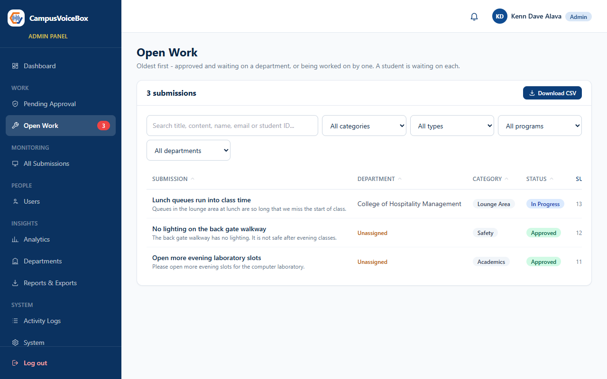

This is every **approved or in-progress** request, concern, complaint and report — the things a department has to act on. A student is waiting on each one. It is sorted **oldest first**.

The **Department** column shows who has it. **Unassigned** in red means nobody does yet — those rows sort to the top and are the ones that need a click. The Dashboard's *Needs Assigning* card counts the same rows.

### 6.2 How to assign a concern to a department

1. Open the item from Open Work. Because it is *Approved* and has no department, the dialog shows **Next step: assign it**.

   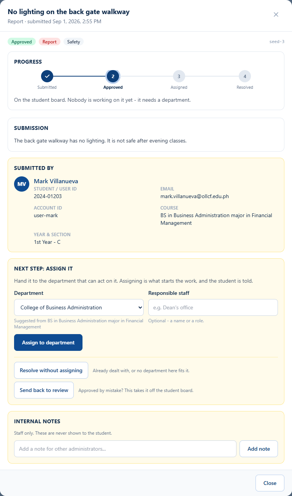

2. Pick the **Department**. If the student's account has a course on it, the dropdown opens on the college that owns that programme, with *"Suggested from …"* under it — check it is right rather than trusting it blindly.
3. Optionally type the **Responsible staff** — a name or a role, e.g. *Dean's office*. It is shown to the student.
4. Click **Assign to department**.

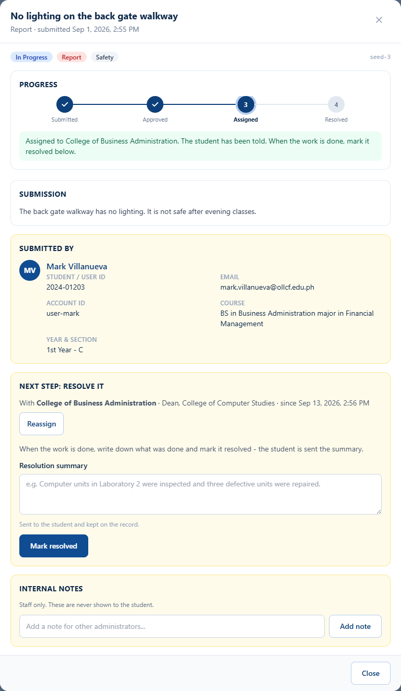

What happens:

- The status becomes **In Progress**. The board shows it as such.
- The student is sent a *Concern assigned* notification naming the department, and their dashboard shows *Being handled by: …*.
- An *Assigned concern* entry is written to the log.
- The dialog moves on to **Next step: resolve it**, and the Departments page now counts this item against that college.

### 6.3 How to resolve a concern

1. Open the item (it will be *In Progress*). The dialog shows **Next step: resolve it**, with the department, responsible staff and assignment date at the top.
2. In **Resolution summary**, write what was actually done — one to three sentences a student can act on. This is **required**, and it is sent to the student word for word.

   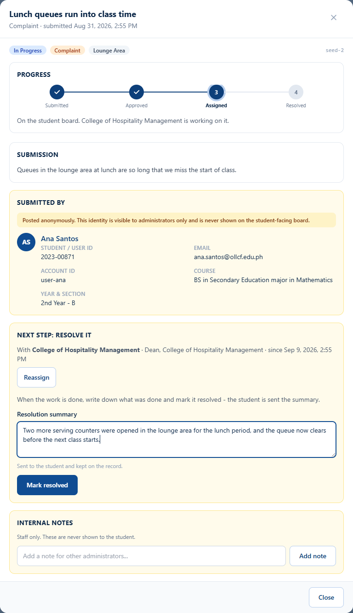

3. Click **Mark resolved**.

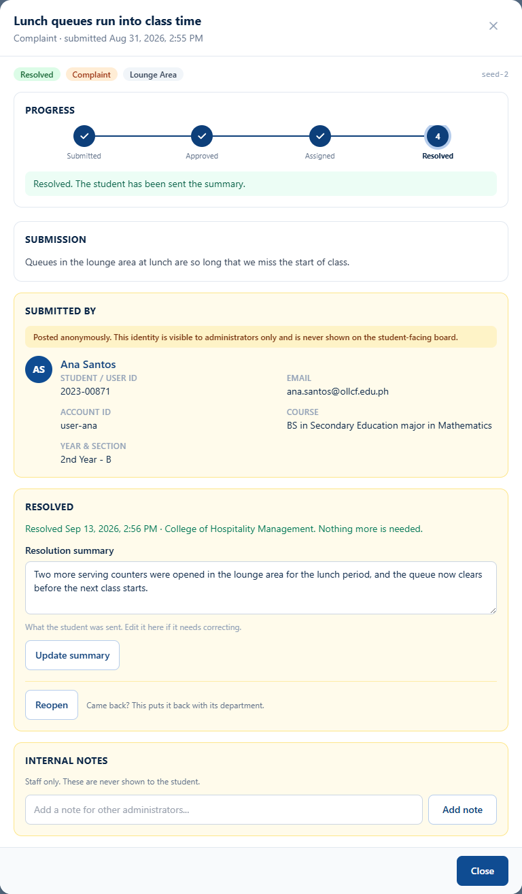

What happens:

- The status becomes **Resolved**. The post stays on the board, marked resolved.
- The student is sent a *Concern resolved* notification with your summary, and their dashboard shows *Resolved: …*.
- A *Resolved concern* entry is written to the log.
- The Departments page records the resolution time for that college.

If you press **Mark resolved** with the summary empty you get *"Please write a short summary of what was actually done."* and nothing changes.

### 6.4 Resolving a plain suggestion

A plain **Suggestion** is not handed to a department, so once approved it simply sits on the board. When the school does act on it, open it (from All Submissions) and you will see **Next step: resolve it** with only the summary box. Write what was done and click **Mark resolved** — the student is sent the summary the same way.

### 6.5 Reassigning, reopening and undoing

Every stage has one or two side paths, listed under the main action in the Next step section:

| You want to… | Where the item is | What to click | Effect |
|---|---|---|---|
| **Move it to a different department** | In Progress | **Reassign** → change the department → **Update assignment** | Department changes; the student is told. |
| **Give a department to something already marked In Progress without one** | In Progress, no department | The assign form is already open — fill it in | Records an owner. |
| **Close something no department fits** | Approved | **Resolve without assigning** → write the summary → **Mark resolved** | Goes straight to Resolved; the student is sent the summary. |
| **Correct the wording of a resolution** | Resolved | Edit **Resolution summary** → **Update summary** | The student is sent the new wording. |
| **Reopen something that came back** | Resolved | **Reopen** | Back to In Progress, with its department. |
| **Take a wrongly approved post off the board** | Approved | **Send back to review** | Back to Under Review — **this removes it from the student board**, so the dialog warns you first. |
| **Reconsider a rejection** | Rejected | **Send back to review** | Back to Under Review, where it can be approved or rejected again. The original reason stays on the record. |

Every one of these notifies the student and writes to the log.

---

## 7. All Submissions

Sidebar → **Monitoring → All Submissions**.

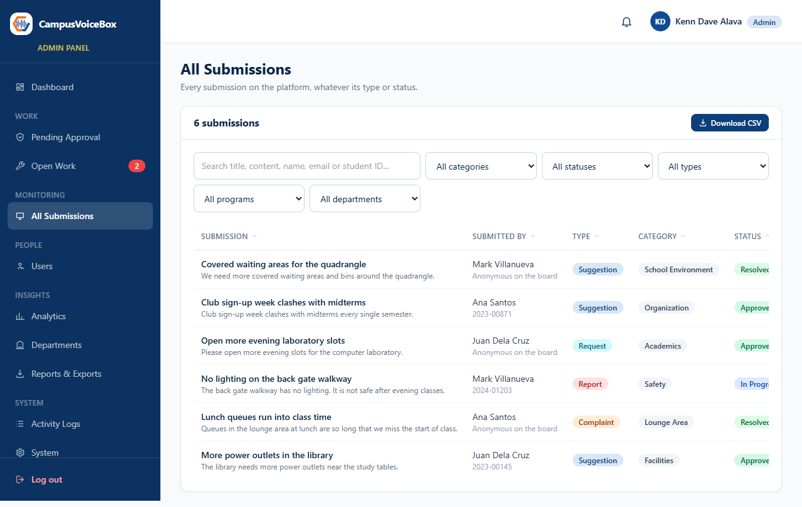

This is the whole record — every submission, of every type and status, newest first. Use it to look something up, to see everything one student or one college has, or to pull a spreadsheet.

**Searching.** The search box matches the title, the message, the submission ID, and the author's name, email or student ID.

**Filtering.** The dropdowns filter by **category**, **status**, **type** (including *Suggestions (all)* and *Concerns (all)* for a whole family), **department** and the author's **programme**. Filters can be combined, and they are kept in the address bar — copy the URL to share a filtered view with another administrator, or bookmark it. **Clear filters** resets everything.

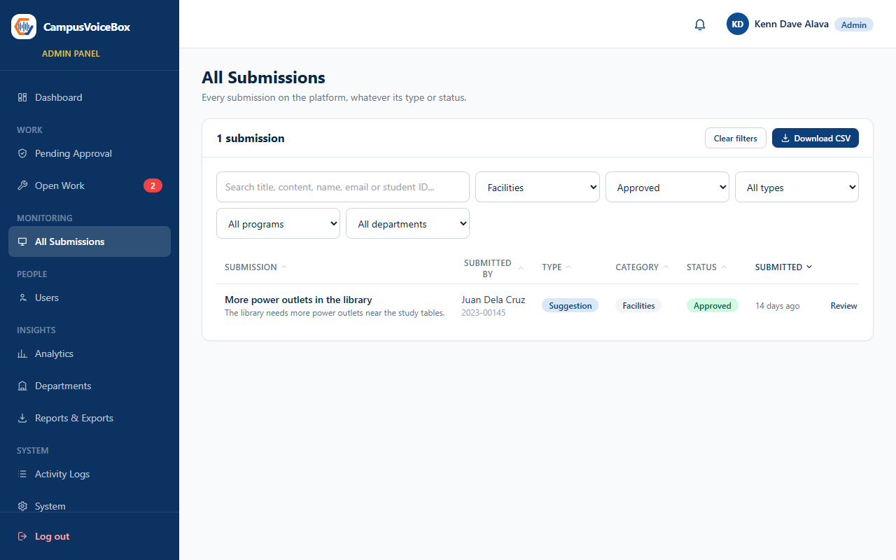

**Sorting.** Click a column heading to sort by it; click again to reverse.

**Opening.** Click a row or its **Review →** link to open the review dialog — the same one as in the queues, with whatever actions are valid for the item's current status.

**Download CSV.** The button in the panel header downloads **exactly the rows you are looking at** — filters included — as a `.csv` named after the view and the date, ready for Excel or Google Sheets. It is disabled when the list is empty.

The same search, filters and download exist on both queues.

---

## 8. Managing users

### 8.1 The Users list

Sidebar → **People → Users**.

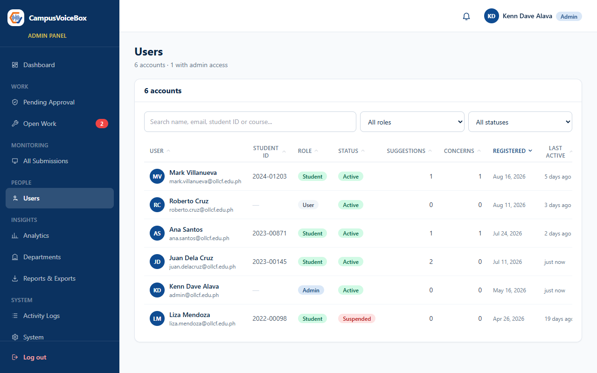

Every account on the platform, newest first. The heading tells you the total and how many have admin access. Each row shows the name and email, student ID, role, status, how many suggestions and concerns they have submitted, when they registered and when they were last active.

Search by name, email, student ID, course or account ID; filter by **role** or **status** (Active / Suspended). Click a row or its **Profile →** link to open the account.

### 8.2 A user's profile page

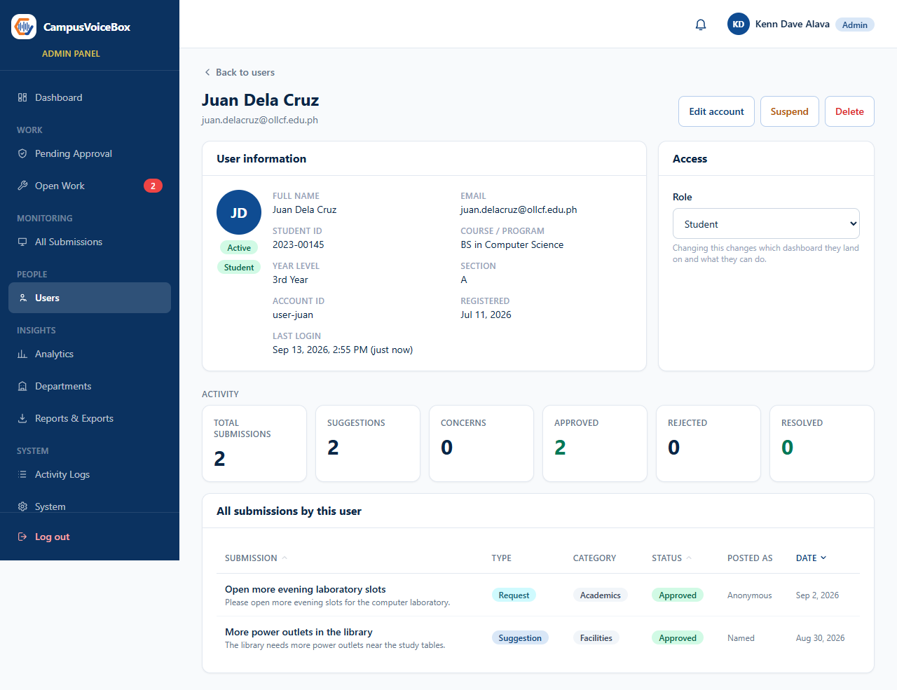

The page has:

- **Header** — name and email, with the action buttons: **Edit account**, **Suspend** (or **Reactivate**), **Delete**.
- **Profile** — the account's fields (full name, email, student ID, course, year, section), read-only until you click Edit.
- **Access** — the role, with a dropdown to change it.
- **Activity** — total submissions, suggestions, concerns, approved, rejected and resolved counts.
- **Submissions** — every post this account has made, each opening the review dialog.

### 8.3 Editing an account

1. Click **Edit account**.
2. Change any field — including the **email**, which the student cannot change themself.
3. Click **Save changes**.

The **name** and **email** cannot be left empty, the email must be a valid address, and it cannot be one another account already uses. An *Updated account* entry is written to the log, naming the fields that changed; saving without changing anything writes nothing.

**School details need the person's consent.** Student ID, course, year level and section are kept only if the person allowed it (at sign-up, or later on their own account page). For somebody who has not, you cannot add or change them — the server refuses — but you can clear them. The person gives that consent themself; an administrator cannot give it for them.

### 8.4 Suspending and reactivating

**To suspend:** click **Suspend**, read the confirmation, click **Suspend account**.

A suspended account cannot **log in**. If the person is already signed in when you suspend them, they can keep reading the board but posting and voting are turned off and their dashboard tells them to contact the Student Affairs office. They are sent an *Account suspended* notification. Their existing posts stay where they are.

**To reactivate:** open the account and click **Reactivate**, then **Reactivate account**. They can log in, post and vote again immediately, and are sent an *Account activated* notification.

Both are written to the log. You cannot suspend your own account.

### 8.5 Changing a role

In the **Access** panel, pick a new role from the dropdown. It takes effect immediately — the change is logged, and the person lands on the matching dashboard next time they navigate.

- Promote a staff member to **Admin** to give them the panel.
- Demote an Admin to **User** or **Student** to take it away.

You cannot change your own role; the dropdown is replaced by a note on your own page. This is deliberate — it stops an administrator locking themself out by accident.

### 8.6 Deleting an account

1. Click **Delete**.
2. Read the confirmation carefully — **this cannot be undone**.
3. Click **Delete permanently**.

The account is removed and you are returned to the Users list. **Their submissions and votes are kept** — a concern still being worked on is not lost, and a vote they cast still counts — but the submissions no longer have an owner; the review dialog shows *"The account that submitted this has been deleted."* A *Deleted account* entry is written to the log. You cannot delete your own account.

Prefer **suspending** over deleting unless there is a specific reason to remove the account.

### 8.7 Forgotten passwords

Administrators do not reset passwords. Somebody who has forgotten theirs resets it themself: **Forgot password?** on the log-in page emails them a link that works once, for one hour, to choose a new one. Nobody else ever sees or chooses their password, and they are signed out on every device when it changes. A *Changed password* entry is written to the log - never the password.

If a student says the email never arrives:

- ask them to check their spam folder and to use the **newest** email (asking again replaces the older link);
- check that their **email on their account** is right — correct it with **Edit account** if it is not;
- if nobody receives reset emails, the mail server is not set up — tell whoever runs the server (`SMTP_*` settings, see GUIDE.md).

*Reset a password* entries in older parts of the log are from before this change, when administrators handed out temporary passwords.

---

### 8.8 Privacy requests

Sidebar → **People → Privacy Requests**.

People ask here for what their account page cannot do by itself: **Access** (a copy of something the download does not include — for example the staff notes on their posts), **Correction** (something they cannot edit, such as their email), **Account deletion**, or **Other** (another privacy question, or an objection to a use of their information). This is kept apart from the submission queues on purpose — it is not moderation.

The list shows open requests, oldest first; the filter shows all of them, or one status. Click a request to open it.

| Button | What it does |
|---|---|
| **Start handling** | Marks it *Being handled*. The person is notified. A reply is optional. |
| **Complete** | Done. A **reply** is required — say what was done. The person sees it on their account page and in a notification. |
| **Decline** | Not done. A **reply** is required — say why. |
| **Delete account and complete** | For a deletion request. Choose first whether their submissions are **kept, without their name** (for example, a concern still being worked on) or **deleted too, with their attachments**. It asks you to confirm, and cannot be undone. |

Things to know:

- **Nobody handles a request about their own account.** Yours appear with a *Your own account* tag and no buttons — another administrator must handle them.
- **A deleted account cannot read your reply.** There is no email, so if the person needs to know the outcome, contact them at the email address shown on the request.
- **Access requests** for things outside the download — staff notes, for example — are sent to the person outside CampusVoiceBox; complete the request saying what was sent.
- **The privacy log** at the bottom of the page records every request made, cancelled and handled, and every time somebody downloaded their own data. It cannot be edited. Deleting an account is *also* written to the Activity Logs.

## 9. Insights

### 9.1 Analytics

Sidebar → **Insights → Analytics**.

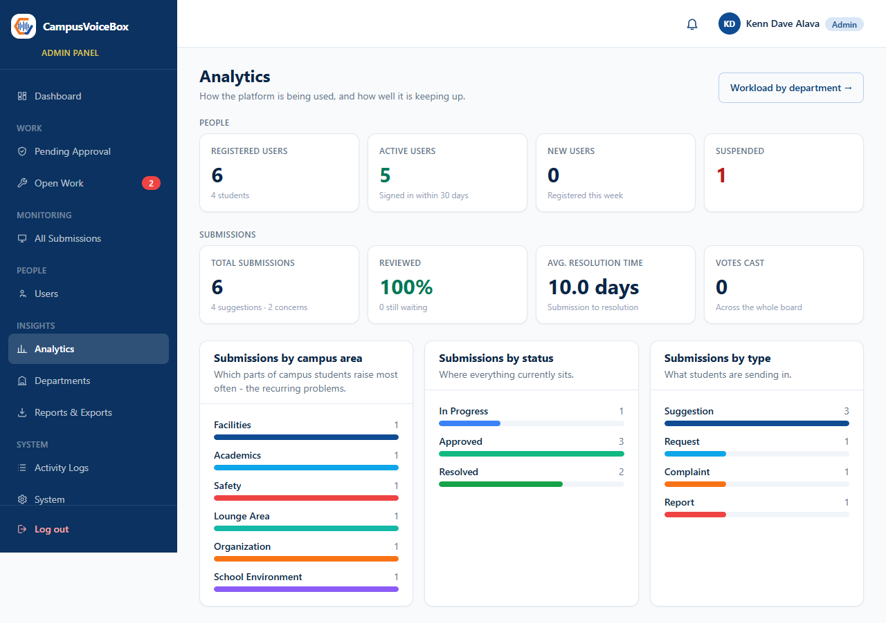

The totals and trends for the whole platform:

| Card | Meaning |
|---|---|
| **Registered Users** | Every account, with the student count underneath. |
| **Active Users** | Accounts that signed in within the last 30 days. |
| **New Users** | Registered this week. |
| **Suspended** | Currently suspended accounts. |
| **Total Submissions** | Everything ever submitted, split into suggestions and concerns. |
| **Reviewed** | Submissions that have had a decision, with how many are still waiting. |
| **Avg. Resolution Time** | Average days from submission to resolution, across everything resolved. |
| **Votes Cast** | Every vote on the board. |

Below them, three charts: **Submissions by campus area** (which categories come up most — the recurring problems), **by status** (where everything currently sits) and **by type**.

### 9.2 Departments

Sidebar → **Insights → Departments**.

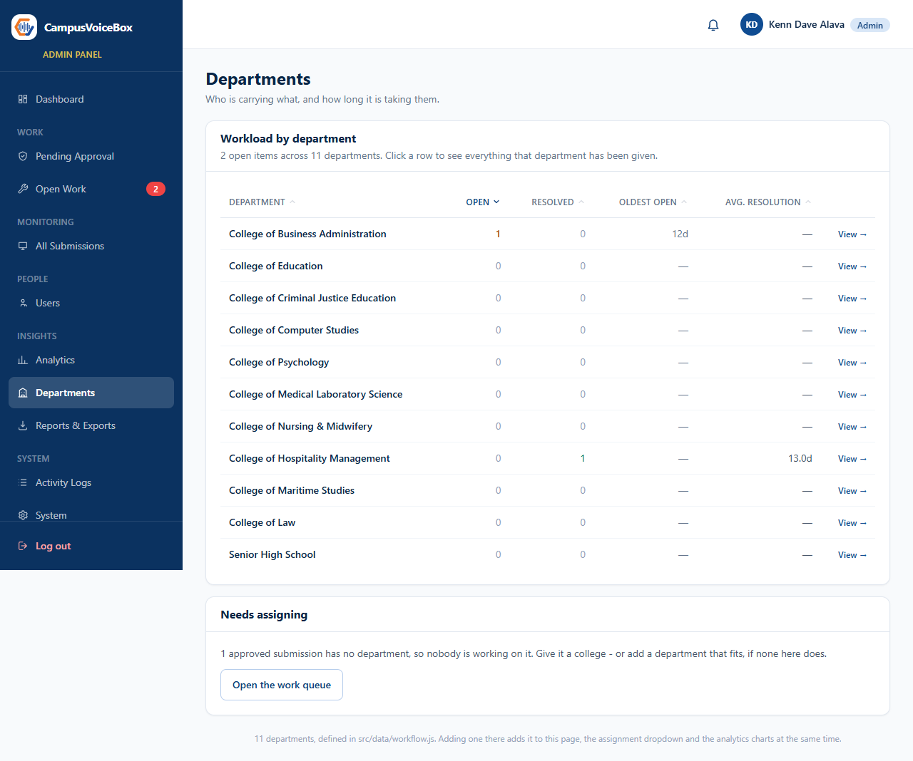

Who is carrying what, and how long it is taking them. One row per department with:

| Column | Meaning |
|---|---|
| **Open** | Items currently assigned and In Progress. |
| **Resolved** | Items it has closed. |
| **Oldest open** | How long its longest-running item has been open. |
| **Avg. resolution** | Average days from assignment to resolution. |

The header counts open items across all departments, and a warning appears when any approved items are **Unassigned** — because those belong to nobody's row. Click a row to jump to All Submissions filtered to that department.

### 9.3 Reports & Exports

Sidebar → **Insights → Reports & Exports**.

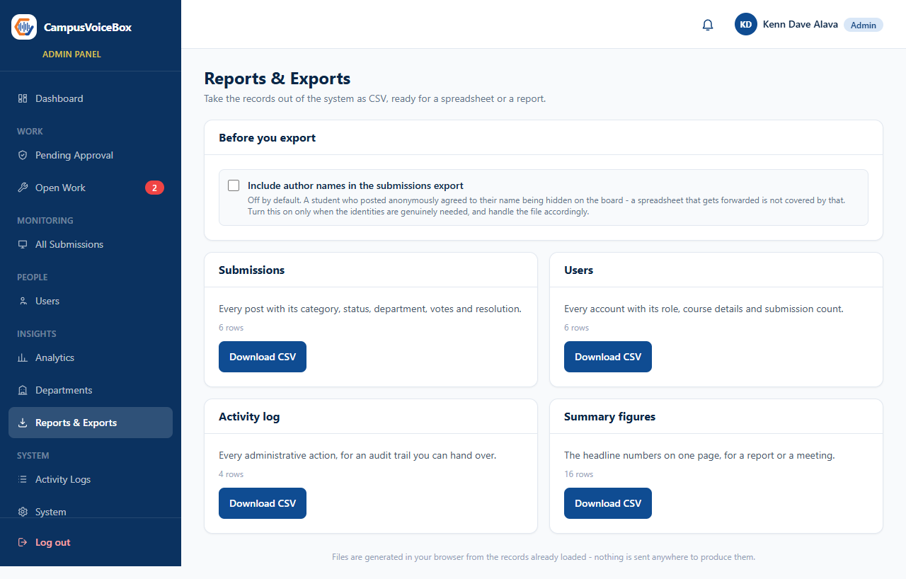

Four downloads, each a CSV generated in your browser from the records already loaded — nothing is sent anywhere:

| Report | Contains |
|---|---|
| **Submissions** | Every post with its category, status, department, votes and resolution. |
| **Users** | Every account with its role, course details and submission count. |
| **Activity log** | Every administrative action — an audit trail you can hand over. |
| **Summary figures** | The headline numbers on one page, for a report or a meeting. |

Each panel says how many rows the file will hold. Click **Download CSV**.

> **The identity switch.** *Include author names in the submissions export* is **off by default**. A student who posted anonymously agreed to their name being hidden on the board; a spreadsheet that gets forwarded is not covered by that. Turn it on only when the identities are genuinely needed, and handle the file accordingly. While it is on, a red line reminds you that every author will be named, anonymous or not.

---

## 10. Notifications

Click the **bell** in the top bar.

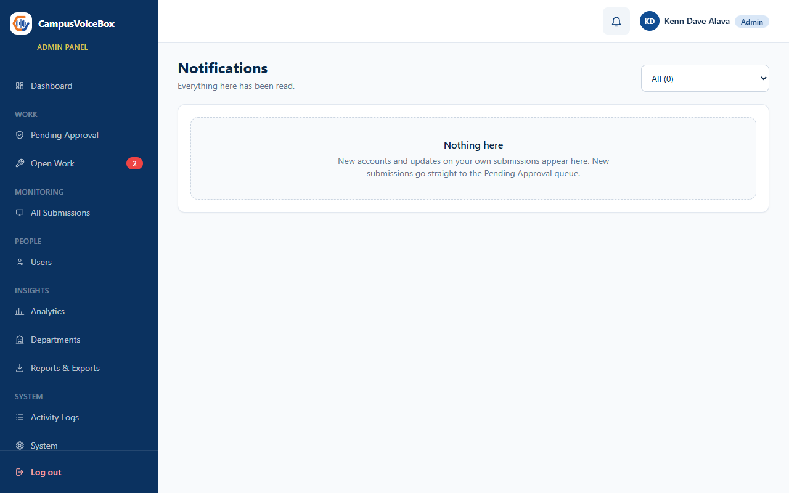

Notifications are for things that have **no queue of their own**. A new submission is *not* notified here — it is already the newest row in Pending Approval with the sidebar badge counting it. What does arrive:

- **New user** — someone registered an account. Click it to open their profile.
- Updates about **your own** submissions, if you have posted any.

A blue dot marks an unread notification; clicking one marks it read. Filter the list with the dropdown (*All*, *Unread*, or one type) and use **Mark all as read** to clear the count on the bell.

---

## 11. Activity Logs

Sidebar → **System → Activity Logs**.

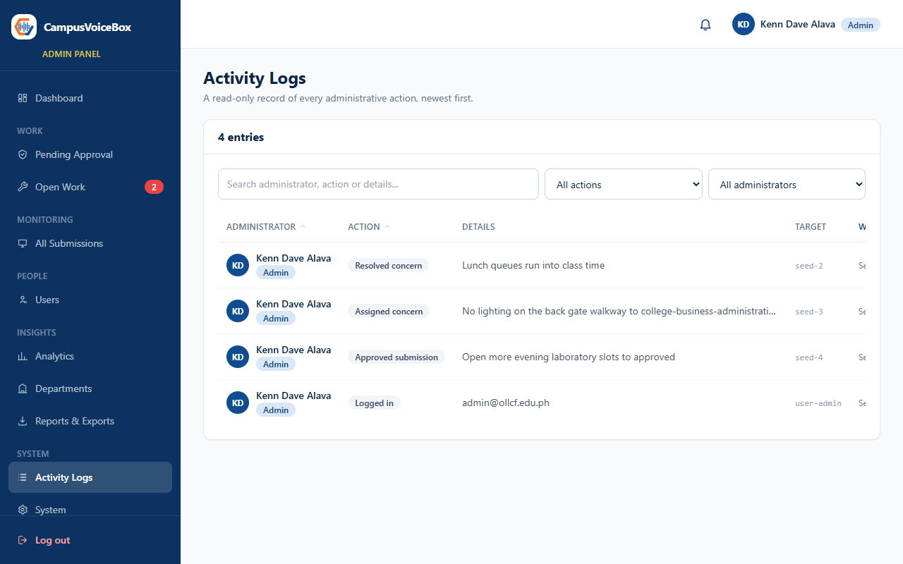

A read-only record of **every administrative action**, newest first: who did it, what they did, the details, what it was done to, and when. The actions recorded are:

Logged in · Logged out · Approved submission · Rejected submission · Changed status · Assigned concern · Resolved concern · Added admin note · Suspended account · Activated account · Updated account · Changed password · Reset a password (older entries only) · Deleted account · Changed account role · Became the first administrator

Search by administrator, action or details; filter by **action** or by **administrator**. Nothing here can be edited or deleted from the panel. The page lists the **latest 500** entries; the *Activity log* download on Reports & Exports always holds the whole log.

---

## 12. System

Sidebar → **System → System**.

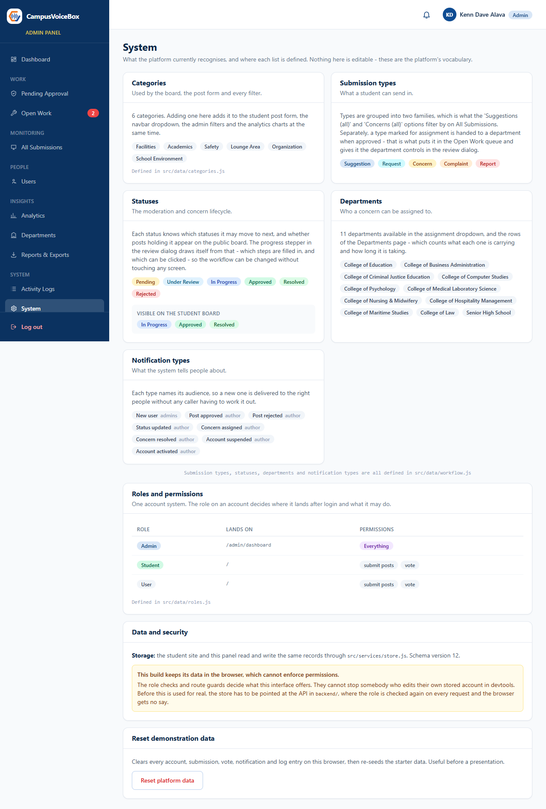

A read-only reference of everything the platform currently recognises — the lists in [section 3](#3-the-vocabulary) — and where each is defined in the code, for whoever maintains it:

- **Categories** — the six areas.
- **Submission types** — the five types, their families, and which need a department.
- **Statuses** — each one, whether it is public, and where it may move next.
- **Departments** — the eleven owners.
- **Notification types** — what the platform tells people about, and who receives each.
- **Roles and permissions** — every role, where it lands, and what it may do.

At the bottom, **Data and security** says where the records are kept — on the server, in its database — and what actually protects them: the server checks the signed-in account's role on every request. See also [section 15](#15-important-notes-about-this-build).

---

## 13. Your own profile

Click your **name and avatar** in the top bar. Your profile is your own entry in the Users list, with the same fields and activity counts as anyone else's — and with **Suspend**, **Delete** and the role dropdown left out, because an administrator must not be able to do those to themself. A note on the page says so.

You can still **Edit account** to correct your own name or details. To change your password, use the **Password** panel: your current password, then the new one twice. You stay logged in; any other device you were logged in on is logged out.

Below that is **Privacy & Data** — the same panel students have: the policies and what you accepted, your consent for school details, your cookie choice, **Download my data**, and privacy requests about your own account (which another administrator handles).

---

## 14. Frequently asked questions

**A student says they posted something and it has vanished.**
It has not — it is in **Pending Approval**. Nothing appears on the board until an admin approves it. If it is not in the queue either, check **All Submissions** with the status filter set to *Rejected*, and search by their name or email.

**I approved something by mistake.**
Open it and click **Send back to review**. It comes off the board immediately and returns to Under Review; the student is told the status changed. Then reject it with a reason, or approve it again.

**I rejected something and the student has appealed.**
Open it (All Submissions → status *Rejected*) and click **Send back to review**. Decide again. The original rejection reason stays on the record, marked *Previously rejected*.

**Which department should a concern go to?**
The dialog suggests the college that owns the student's programme. If the concern is about a specific college, pick that one instead. If nothing fits — a campus-wide facilities problem, say — leave it, deal with it through the right office, then **Resolve without assigning** with a summary of what was done.

**The Needs Assigning card is red. What do I do?**
Open **Open Work**; the *Unassigned* rows are at the top. Assign each one, or resolve it without assigning if it has been dealt with.

**Can I edit a student's post?**
No. You can approve, reject, assign, resolve, note, and send back — never rewrite what a student wrote. If a post needs changes, reject it with a reason that says what to change, and the student can post again.

**Can I see who posted anonymously?**
Yes, in the *Submitted by* section of the review dialog — and only there. It is never on the board and is left out of the submissions export unless you switch it on.

**Why is there no "new submission" notification?**
Because the Pending Approval queue *is* that notification — the sidebar badge shows the count, and it clears itself as you approve. A second badge for the same fact was noise.

**Two administrators opened the same submission.**
Whichever presses a button first wins. The panel refreshes itself every 15 seconds and whenever you come back to its tab, so the other admin soon sees the change; if they press a button that no longer applies first, they are told the submission has already moved on, and the dialog shows where it now stands. Use **Mark as under review** to signal that you are handling something.

**Can I reset a student's password?**
No — they reset it themselves with **Forgot password?** on the log-in page, which emails them a link; see [8.7](#87-forgotten-passwords). Nobody but the student ever sees or chooses their password.

**A student asked for their account to be deleted.**
Open **People → Privacy Requests**, open the request, write a reply, choose whether their submissions are kept or deleted, and press **Delete account and complete**. See [8.8](#88-privacy-requests).

**A box asks me to accept the Terms & Conditions.**
The Terms changed in a way everybody has to accept. Until you do, you cannot post or vote — reviewing and managing are not affected.

**An admin left. How do I remove their access?**
Open their account and change the role to *User* (or *Student*). Suspend or delete it as well if the account itself should go. You cannot do this to yourself — another admin must.

---

## 15. Important notes about this build

Read this before the platform is used with real students.

**Everything lives on the server.** Every account, submission, vote, notification and log entry is kept in the server's database. Every computer and phone sees the same platform, and the panel refreshes itself every 15 seconds and whenever you come back to its tab.

**The server checks every permission.** The role checks and route guards in the panel only decide what it *shows*. Every action is checked again by the server, against the account as it is in the database at that moment — so a suspension, a role change or a password reset takes effect immediately, wherever that person is signed in.

**The administrator is the default account.** It is created by the server when it is installed, from `ADMIN_EMAIL` and `ADMIN_PASSWORD` (see GUIDE.md). Signing up on the website only ever makes student and user accounts, and only an administrator can change that.

**Keep a second administrator.** A forgotten password is reset by its owner with the emailed link — which only works if the school's mail server is set up and the administrator's mailbox still exists. So promote a second, trusted account early. If the only administrator is locked out anyway, whoever runs the server can promote a new account with `npm run make-admin -- someone@school.edu.ph` (see GUIDE.md).

**The policies are drafts.** The Privacy Policy, Terms & Conditions and Cookie Policy describe what the platform actually does, but some facts only the school can supply — who is responsible for the data, the Data Protection Officer's contact, how long records are kept, where the server is hosted — are highlighted as *To be confirmed*, and some parts are marked *For legal review*. Fill the facts in (`frontend/src/data/policies.js`) and have the marked parts reviewed before relying on them.

**Limits on repeated attempts.** After ten wrong passwords for one account, logging in to it is paused for 15 minutes. One account can post ten times an hour. Both reset by themselves.

---

*CampusVoiceBox · Our Lady of Lourdes College Foundation · Admin Manual*
