# CampusVoiceBox — Student Manual

**Our Lady of Lourdes College Foundation · Daet, Camarines Norte**

This manual is for students, staff and anyone else with a CampusVoiceBox account who wants to post a suggestion, raise a concern, vote on what other students have raised, and follow what happens next.

If you administer the platform, see the [Admin Manual](ADMIN-MANUAL.md) instead.

---

## Contents

1. [What CampusVoiceBox is](#1-what-campusvoicebox-is)
2. [Getting started](#2-getting-started)
   - 2.1 [Opening the site](#21-opening-the-site)
   - 2.2 [A tour of the landing page](#22-a-tour-of-the-landing-page)
   - 2.3 [Creating an account](#23-creating-an-account)
   - 2.4 [Logging in](#24-logging-in)
   - 2.5 [Logging out](#25-logging-out)
   - 2.6 [Changing or forgetting your password](#26-changing-or-forgetting-your-password)
3. [Browsing the board](#3-browsing-the-board)
   - 3.1 [Reading a card](#31-reading-a-card)
   - 3.2 [Searching and filtering](#32-searching-and-filtering)
   - 3.3 [Voting](#33-voting)
4. [Posting](#4-posting)
   - 4.1 [Suggestion or Voice Out? The five types](#41-suggestion-or-voice-out-the-five-types)
   - 4.2 [How to post a suggestion](#42-how-to-post-a-suggestion)
   - 4.3 [How to voice out a concern](#43-how-to-voice-out-a-concern)
   - 4.4 [The rules every post must follow](#44-the-rules-every-post-must-follow)
   - 4.5 [What happens after you submit](#45-what-happens-after-you-submit)
5. [Tracking your submissions](#5-tracking-your-submissions)
   - 5.1 [Your dashboard](#51-your-dashboard)
   - 5.2 [What each status means](#52-what-each-status-means)
   - 5.3 [Notifications](#53-notifications)
   - 5.4 [Finding your posts on the board](#54-finding-your-posts-on-the-board)
6. [Your account](#6-your-account)
   - 6.1 [Privacy & Data](#61-privacy--data)
7. [Using CampusVoiceBox on a phone](#7-using-campusvoicebox-on-a-phone)
8. [Frequently asked questions](#8-frequently-asked-questions)

---

## 1. What CampusVoiceBox is

CampusVoiceBox is the school's online suggestion box. It is a public board where students post what should be improved on campus, upvote what other students have raised, and follow each submission from the moment it is sent in until the school has acted on it.

Three things make it different from a paper suggestion box:

- **It is public.** Once a submission is approved, every student can read it and vote on it, so the school can see which issues matter most.
- **It is tracked.** Every submission has a status. You are told when it is approved, when it is handed to a department, and what was done about it.
- **It is moderated.** An administrator reads every submission before it appears on the board, and rude or offensive posts are not accepted.

---

## 2. Getting started

### 2.1 Opening the site

Open a web browser (Chrome, Edge, Firefox or Safari) and go to the address your school gave you. During development this is:

```
http://localhost:3000
```

You do not need an account to **read** the board. You need one to **post** or **vote**.

**On your first visit** a box at the bottom of the screen asks about cookies and browser storage. CampusVoiceBox sets no cookies and has no tracking; it keeps only what it needs to keep you signed in and to remember your answer, plus one optional convenience. Choose **Accept All**, **Reject Optional** or **Customize Preferences** — the site works the same either way. You can change your answer at any time with **Cookie settings** at the bottom of every page.

The **Privacy Policy**, **Terms & Conditions** and **Cookie Policy** are linked at the bottom of every page.

### 2.2 A tour of the landing page

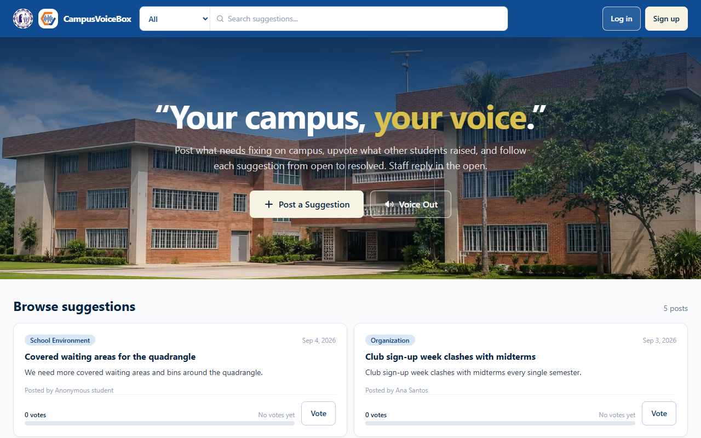

From top to bottom:

| # | What it is | What it does |
|---|---|---|
| 1 | **Navigation bar** (navy strip) | The school seal and the CampusVoiceBox logo on the left take you home. The search box in the middle searches the board, and the dropdown on its left edge filters by category. **Log in** and **Sign up** are on the right (they become your profile circle once you are signed in). |
| 2 | **Hero** ("Your campus, your voice") | Two big buttons: **Post a Suggestion** and **Voice Out**. These open the posting form (see [section 4](#4-posting)). |
| 3 | **Browse suggestions** | The board itself — every approved submission, newest first, with a vote button on each card. The count on the right tells you how many posts match what you are looking at. |

Scroll down to see the whole board:

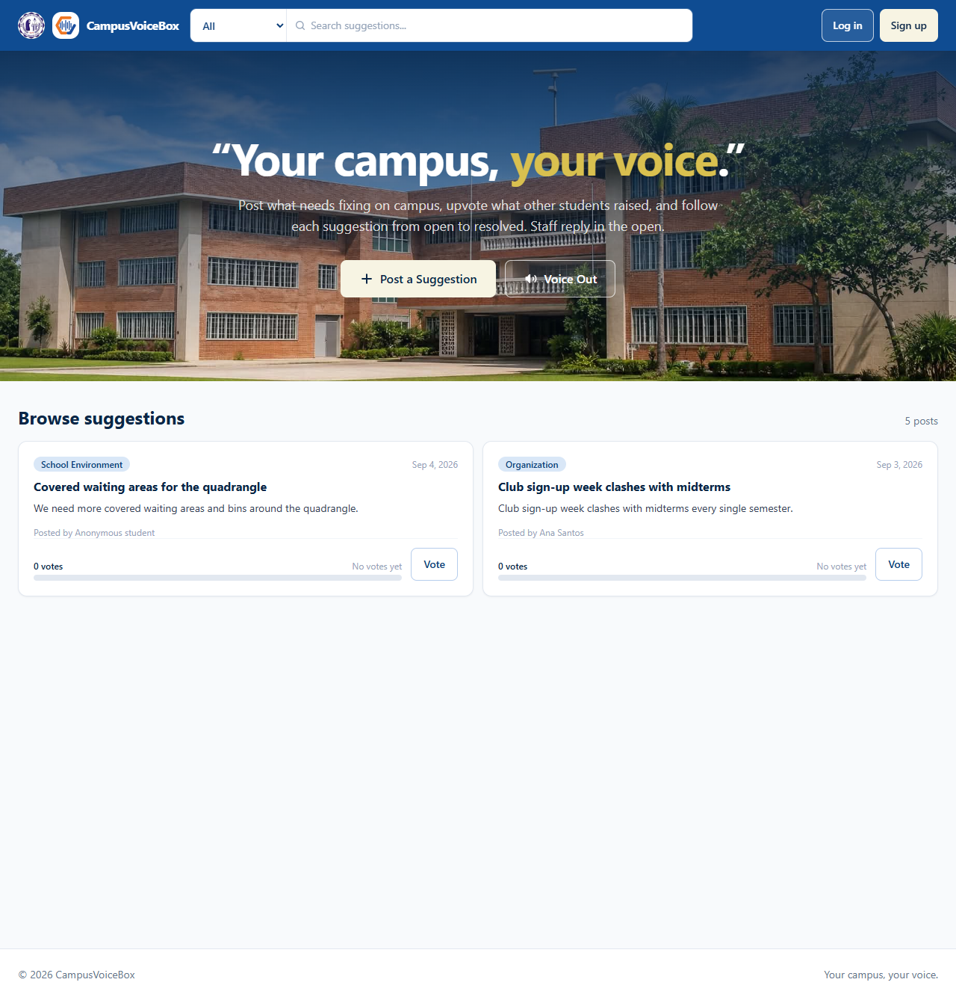

### 2.3 Creating an account

1. Click **Sign up** in the top-right corner (or **Create an account** at the bottom of the log-in page).
2. Fill in the form:

   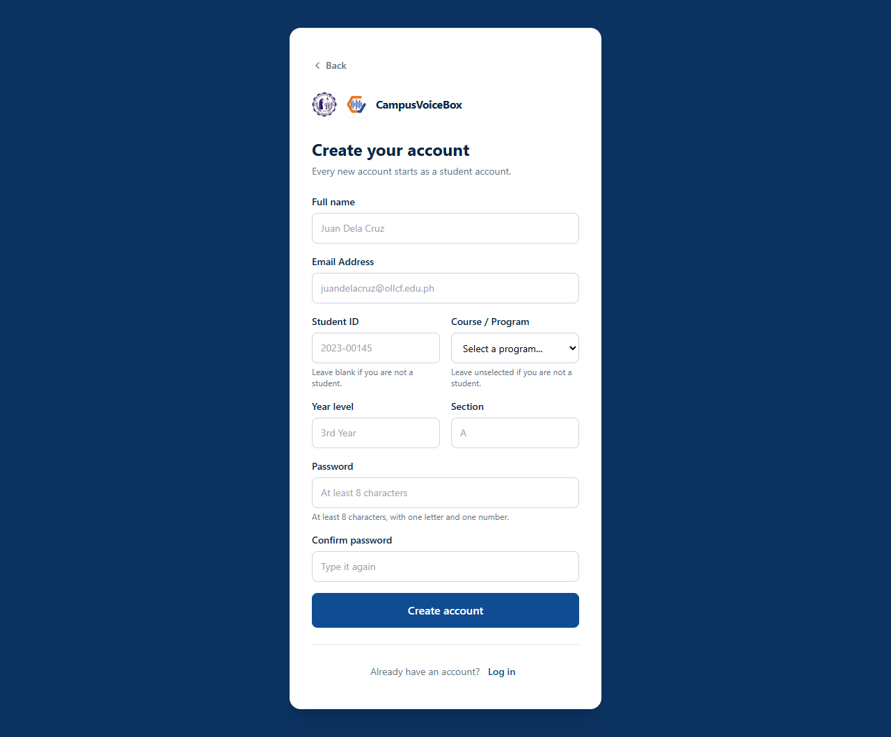

   | Field | Required? | Notes |
   |---|---|---|
   | **Full name** | Yes | Shown on your posts unless you post anonymously. |
   | **Email Address** | Yes | Your school email, e.g. `juandelacruz@ollcf.edu.ph`. This is what you log in with, and it cannot be changed later from your own account. |
   | **Student ID** | No | e.g. `2023-00145`. Filling this in makes yours a **student** account. Leave it blank if you are staff or a visitor — you get a general **user** account instead, which can still post and vote. |
   | **Course / Program** | No | Pick your programme from the list. It helps the school route your concerns to the right college. |
   | **Year level** and **Section** | No | e.g. `3rd Year`, `A`. |
   | **Optional: let CampusVoiceBox keep my school details** | Only if you filled in any of the four school fields | Your school details are kept only if you tick this. If you would rather not, leave the four fields blank. You can change your mind later — see [6.1](#61-privacy--data). |
   | **Password** | Yes | At least **8 characters**, with at least **one letter and one number**. |
   | **Confirm password** | Yes | Type the same password again. |
   | **I accept the Terms & Conditions and have read the Privacy Policy** | Yes | The links open in a new tab, so you do not lose what you typed. The box is never ticked for you. |

3. Click **Create account**.
4. You are signed in immediately and taken to the board.

If something is wrong, the field that needs fixing is outlined in red with a message underneath it. Common ones:

- *"Please enter a valid school email address."* — check for a typo, and that there is an `@` and a dot.
- *"Use at least 8 characters, with one letter and one number."* — the password is too short or is only letters or only numbers.
- *"The two passwords do not match."* — retype the confirmation.
- *"An account with that school email already exists."* — you already signed up; use **Log in** instead.
- *"Tick the box to let CampusVoiceBox keep your school details, or leave them blank."* — you filled in a school field but did not tick the box for it.
- *"Please accept the Terms & Conditions to create your account."* — tick the box above **Create account**.
- *"The Terms or the Privacy Policy changed while this page was open..."* — reload the page, read them again, and sign up.

> **Screenshots in this manual** were taken before the two tick boxes were added to the sign-up form and the privacy notice to the posting form; the forms otherwise look the same.

### 2.4 Logging in

1. Click **Log in** in the top-right corner.

   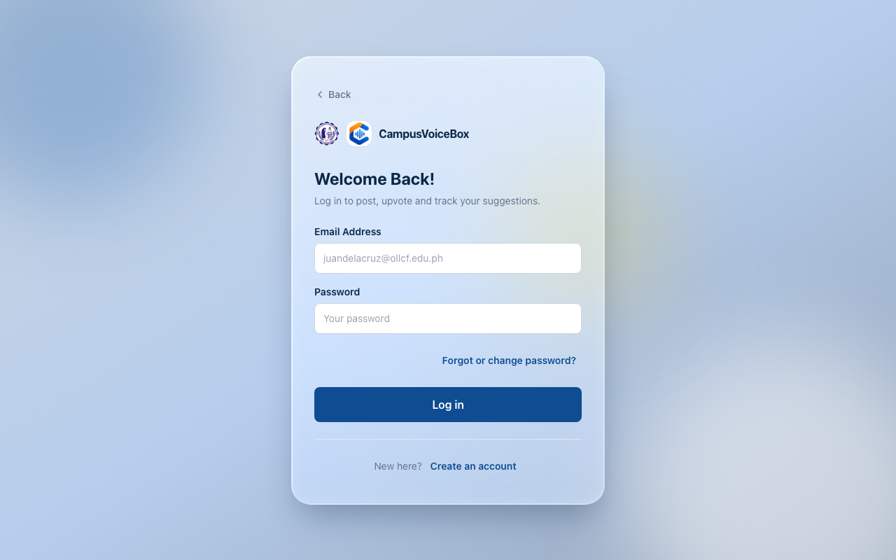

2. Enter your **Email Address** and **Password**.
3. Click **Log in**.

Forgot your password? Click **Forgot password?** under the password box — see [2.6](#26-changing-or-forgetting-your-password).

You are taken to the board. If you were sent to the log-in page because you tried to vote or post without being signed in, you land back on the board — vote or post again and it will go through.

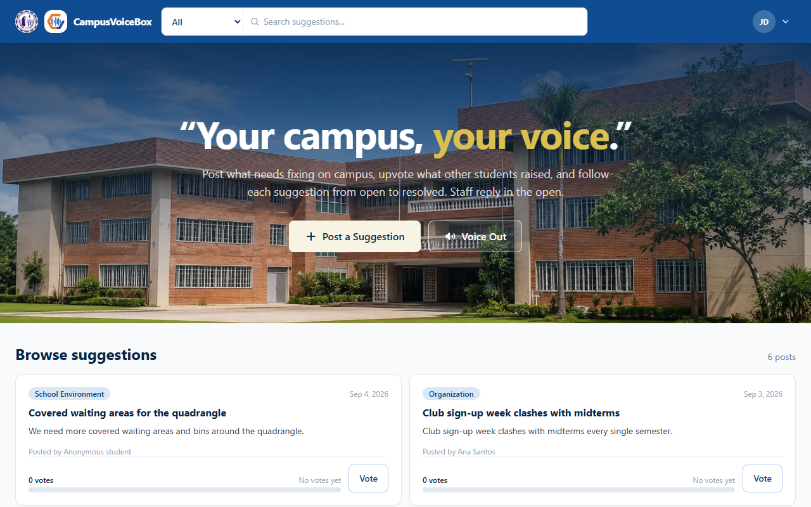

Messages you might see:

- *"Please fill in both fields."* — one of the boxes is empty.
- *"That email and password do not match an account."* — check for typos; passwords are case-sensitive. If you have never signed up, use **Create an account** instead.
- *"This account has been suspended. Please contact the Student Affairs office."* — an administrator has suspended your account; see [section 8](#8-frequently-asked-questions).

### 2.5 Logging out

1. Click your **profile circle** (your photo, or your initials) in the top-right corner.
2. Click **Log out** at the bottom of the menu.
3. A confirmation appears. Click **Yes, log out**.

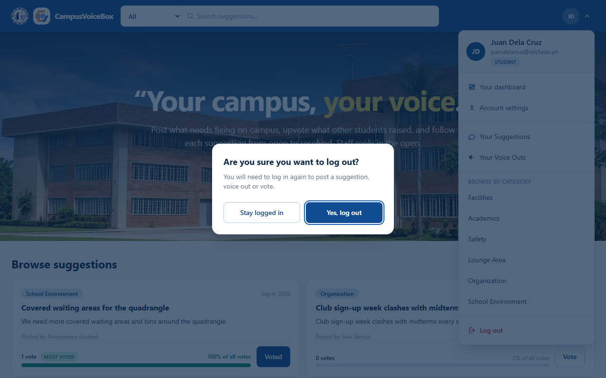

Always log out on a shared or laboratory computer.

### 2.6 Changing or forgetting your password

**You know your password and want a new one.** Log in, open your profile menu, click **Account settings**, and use the **Password** panel:

1. Type your **Current password**.
2. Type a **New password** — at least 8 characters, with at least one letter and one number — and type it again in **Confirm new password**.
3. Click **Change password**. A green message confirms it. You stay logged in here; any other computer or phone you were logged in on is logged out.

**You forgot your password.**

1. On the log-in page, click **Forgot password?** under the password box. Whatever email you typed comes with you.
2. Check the email and click **Email me a reset link**. The page says *"If that email belongs to an account, a link to reset its password is on its way"* — it says the same for every email, so nobody can use it to find out who has an account.
3. Open the email from CampusVoiceBox and click the link. It works **once**, for **one hour**.
4. Type your **New password** twice and click **Save new password**. You are logged out everywhere; click **Log in** and use the new password.

No email? Check your spam folder, then ask again (you can ask up to three times in 15 minutes). If the link says it *no longer works*, it was already used, it expired, or you asked for a newer one — use the newest email, or ask again.

---

## 3. Browsing the board

The board is the **Browse suggestions** section of the landing page. It shows every submission that an administrator has approved, newest first. You do not need to be signed in to read it.

### 3.1 Reading a card

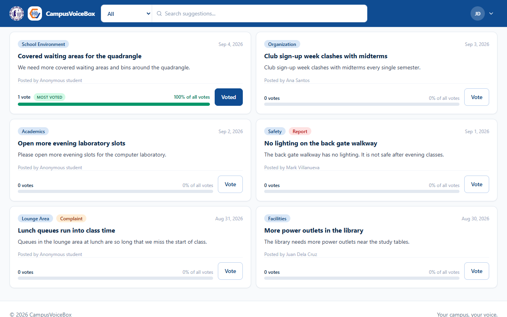

Each card shows:

| Part | Meaning |
|---|---|
| **Category tag** (blue pill, top-left) | Which part of campus life it is about: Facilities, Academics, Safety, Lounge Area, Organization or School Environment. |
| **Type tag** (coloured pill next to it) | Only shown on concerns, complaints and reports — the posts sent in through **Voice Out**. Plain suggestions have no second tag. |
| **Date** (top-right) | When it was submitted. |
| **Title** and **message** | What the student wrote. |
| **Attachments** | Small thumbnails for photos; a file name for a PDF. Click one to open it in a new tab. |
| **Posted by** | The student's name, or *Anonymous student* if they chose to post anonymously. |
| **Vote row** (bottom) | The number of votes, what share of all votes on the board this post has, and the **Vote** button. The post with the most votes carries a green **MOST VOTED** marker. |

### 3.2 Searching and filtering

There are three ways to narrow the board down, and they can be combined.

**Search by words.** Type in the search box in the navigation bar. The board narrows as you type, showing only posts whose title or message contains those words.

**Filter by category.** Use the dropdown on the left edge of the search box (it says **All** by default; on a phone or small tablet — under 768px wide — it is a filter icon, with a small dot on it while a category is picked). Pick a category and the board narrows to it.

**Show only your own posts.** Open your profile menu and choose **Your Suggestions** or **Your Voice Outs** (see [section 5.4](#54-finding-your-posts-on-the-board)).

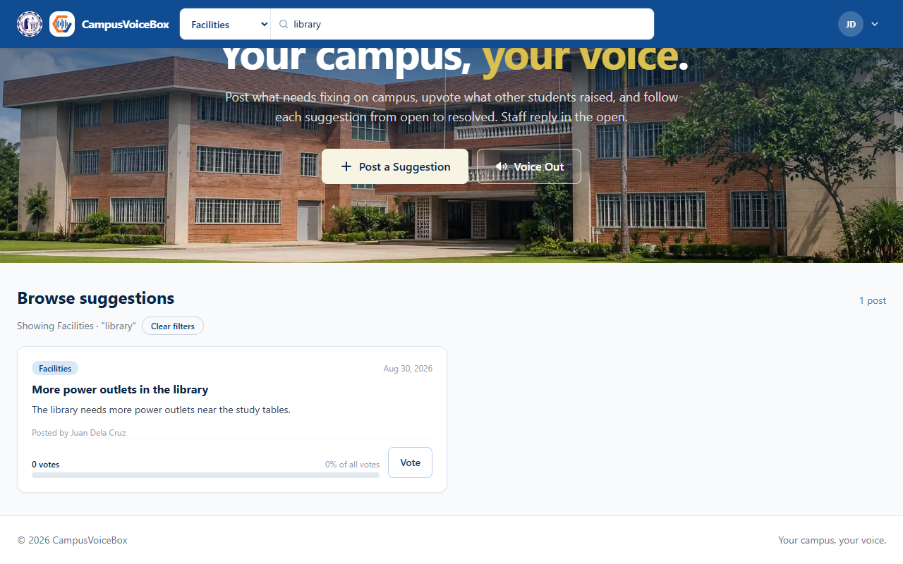

Whenever a filter is active a line under the heading says what you are looking at — for example *Showing Facilities · "library"* — with a **Clear filters** button beside it. Click that to see the whole board again.

If nothing matches you will see *"No posts match your search yet. Try another category, or be the first to post."*

**Change the order.** Beside the number of posts are two buttons: **Newest** (the default) and **Most voted**. Most voted puts the posts with the most votes first; posts with the same number of votes are newest first. Your choice stays when you search, filter or click **Clear filters**.

**Load more.** The board shows ten posts at first. If there are more, a **Load more** button at the bottom shows the next ten, with a line such as *Showing 10 of 23* above it. A new search, filter or order starts again from the first ten.

### 3.3 Voting

Voting is how you tell the school that a post matters to you too. Upvote the posts you agree with — the most-voted issues are the ones the school sees first.

1. Sign in (if you are not, pressing **Vote** sends you to the log-in page and then back).
2. Find the card and click **Vote**.
3. The button changes to **Voted**, the count goes up by one, and the bar under it grows.

To take your vote back, click **Voted** again.

Rules:

- **One vote per post.** You cannot vote twice on the same card.
- You can vote on as many different posts as you like, including your own.
- Votes are counted live — if you have the board open in two tabs, a vote in one appears in the other.
- If your account is suspended while you are signed in, voting is turned off and the board tells you so.

---

## 4. Posting

There are two buttons in the hero: **Post a Suggestion** and **Voice Out**. Both open the same form; the only difference is which *type* is selected when it opens. You can change the type inside the form.

### 4.1 Suggestion or Voice Out? The five types

| Type | Opens from | Use it when… | What the school does with it |
|---|---|---|---|
| **Suggestion** | Post a Suggestion | You have an idea for improving something. | Reviewed and, if approved, published to the board for votes. |
| **Request** | Post a Suggestion | You are asking for something specific to be provided or changed. | Reviewed, published, then **handed to a department** to act on. |
| **Concern** | Voice Out | Something on campus is bothering you or is not working. | Reviewed, published, then **handed to a department** to act on. |
| **Complaint** | Voice Out | Something has gone wrong and you want it put right. | Same as a concern. |
| **Report** | Voice Out | You are reporting a hazard, incident or safety issue. | Same as a concern. |

The line under the *Type of submission* dropdown tells you which of these applies: *"This will be reviewed and, if approved, published to the board"* or *"This will be passed to the department responsible once it is approved."*

### 4.2 How to post a suggestion

1. Sign in.
2. Click **Post a Suggestion** in the hero (or on your dashboard).
3. Fill in the form:

   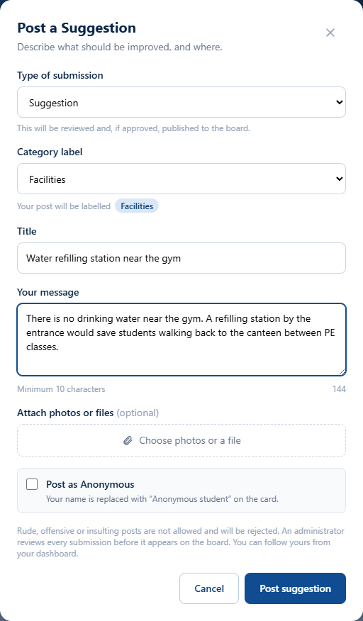

   | Field | What to put |
   |---|---|
   | **Type of submission** | *Suggestion* is already selected. Change it to *Request* if you are asking for something specific. |
   | **Category label** | The area of campus life it belongs to. The pill under the dropdown shows exactly how it will be labelled on the board. |
   | **Title** | A short headline, at least **5 characters** (up to 80). Say *what* and *where*: "More power outlets in the library". |
   | **Your message** | The details, at least **10 characters**. The counter on the right shows how many you have typed. |
   | **Attach photos or files** | Optional — see the rules in [4.4](#44-the-rules-every-post-must-follow). |
   | **Post as Anonymous** | Tick this and the card will say *Anonymous student* instead of your name. Administrators can still see who sent it. |

   Once approved, your post and its files can be seen by **anyone** who visits the board, so do not include other people's personal details.

4. Click **Post suggestion**.
5. The form closes and a blue notice appears above the board: *"Thanks — your submission has been sent for review. You can follow it from your dashboard."*

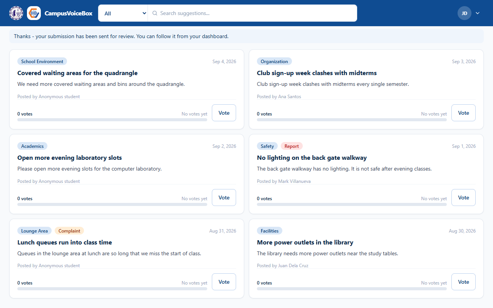

Your post is **not on the board yet** — see [4.5](#45-what-happens-after-you-submit).

### 4.3 How to voice out a concern

1. Sign in.
2. Click **Voice Out** in the hero (or on your dashboard).
3. Fill in the form. It is the same form as above, but the heading reads *Voice Out* and the type starts on **Concern**. Change it to **Complaint** or **Report** if that fits better.

   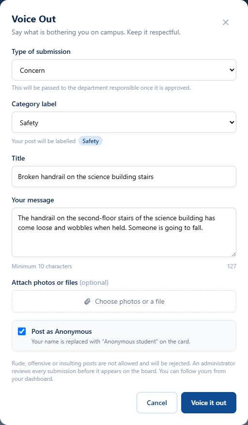

4. Click **Voice it out**.

A voice out goes through the same review, and once approved it is **handed to the college or department responsible**. You will be told which one, and you will be sent a summary when it is resolved.

### 4.4 The rules every post must follow

The form checks these before it accepts the post. If one fails, a red message appears above the buttons and nothing is sent.

| Rule | Detail |
|---|---|
| **Title length** | At least 5 characters, at most 80. |
| **Message length** | At least 10 characters, at most 5000. |
| **Language** | Rude, offensive or insulting words are not allowed — in English or Filipino. The filter checks both the title and the message. A post that fails is refused with a polite warning and is *not* sent to the administrator. |
| **Attachments** | Up to **3 files** per post. Photos and PDFs only. Photos can be up to 8 MB each and are shrunk to about 1000 pixels before saving; a PDF must be under 400 KB. Click the **×** on a thumbnail to remove it before posting. |
| **Anonymous posting** | Hides your name from other students. Administrators can still see who sent it — so they can follow up with you — but your name never appears on the board. |

### 4.5 What happens after you submit

```
 You submit  →  Pending  →  an administrator reviews it
                                    │
                    ┌───────────────┴───────────────┐
                    ▼                               ▼
                Approved                        Rejected
          (now on the board)             (never on the board;
                    │                    you are told the reason)
     for a Request / Concern /
     Complaint / Report only:
                    ▼
               In Progress
       (handed to a department)
                    ▼
                Resolved
       (you are sent a summary
         of what was done)
```

1. **Nothing appears on the board straight away.** Every post starts as *Pending* and is only visible to administrators.
2. An administrator reads it and either **approves** it (it goes on the board) or **rejects** it (it does not, and you are told why).
3. If it is a request, concern, complaint or report, it is then **assigned to a department**, and finally marked **resolved** with a note on what was done.
4. At each of these steps you receive a **notification** on your dashboard.

Reviews are done by people, so this can take a day or more. You can check where your post has got to at any time from **Your dashboard**.

---

## 5. Tracking your submissions

### 5.1 Your dashboard

Open your profile menu (the circle with your photo or initials, top-right) and click **Your dashboard**.

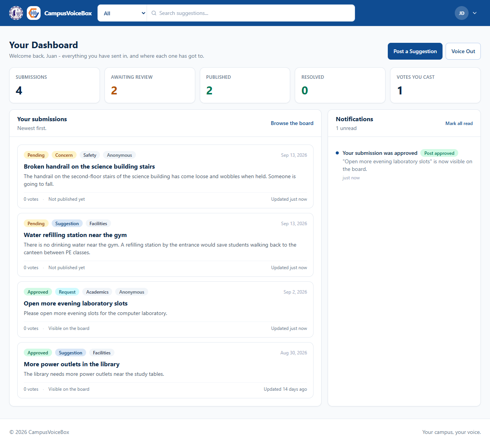

The dashboard has three parts:

**The five counters** across the top:

| Counter | Meaning |
|---|---|
| **Submissions** | Everything you have ever sent in. |
| **Awaiting review** | How many are still *Pending* or *Under Review*. Shown in orange while there are any. |
| **Published** | How many are on the board right now (*Approved*, *In Progress* or *Resolved*). |
| **Resolved** | How many have been acted on and closed. |
| **Votes you cast** | How many posts you have voted for. |

**Your submissions** — every post you have sent, newest first. Each row shows its status pill, type, category, whether it was anonymous, the date, the vote count, and whether it is *Visible on the board* or *Not published yet*. Where there is something to tell you, an extra line appears:

- **Not approved:** *the reason the administrator gave*
- **Being handled by:** *the college or department, and the person responsible if one was named*
- **Resolved:** *the summary of what was done*

**Notifications** — the messages the platform has sent you (see [5.3](#53-notifications)).

The **Post a Suggestion** and **Voice Out** buttons at the top of the dashboard open the same form as the ones on the landing page.

### 5.2 What each status means

| Status | Colour | On the board? | What it means |
|---|---|---|---|
| **Pending** | Amber | No | Sent in and waiting for an administrator to look at it. |
| **Under Review** | Light blue | No | An administrator has opened it and is looking into it before deciding. |
| **Approved** | Green | **Yes** | Published. Other students can read it and vote on it. For a plain suggestion this is usually the final state until the school acts on it. |
| **In Progress** | Blue | **Yes** | Handed to a college or department, which is working on it. Your dashboard says which one. |
| **Resolved** | Dark green | **Yes** | Finished. The department has acted on it and you have been sent a summary of what was done. |
| **Rejected** | Red | No | Not published. Your dashboard shows the reason. Common reasons are that it named an individual, duplicated an existing post, or did not follow the rules in [4.4](#44-the-rules-every-post-must-follow). |

### 5.3 Notifications

The **Notifications** panel on your dashboard lists what the platform has told you, newest first. A blue dot marks an unread one. You are notified when:

- a submission of yours is **approved** or **rejected**
- its **status changes** (for example it is sent back for another look)
- it is **assigned** to a department
- it is **resolved**
- your account is **suspended** or **reactivated**

Click **Mark all read** to clear the dots. The panel keeps your eight most recent notifications; the number of unread ones beside the title counts all of them.

**You do not have to open the dashboard to see that something is new.** The number of unread notifications is shown at the top of every page:

- **On a computer or tablet**, as a red number on the **bell** beside your profile circle. Click the bell to jump straight to this panel.
- **On a phone**, as a red number on your **profile circle**. Tap the circle, then **Notifications**.

The number shows *9+* once there are more than nine, and disappears when you click **Mark all read**.

### 5.4 Finding your posts on the board

Your profile menu has two shortcuts that filter the board to just your own published posts:

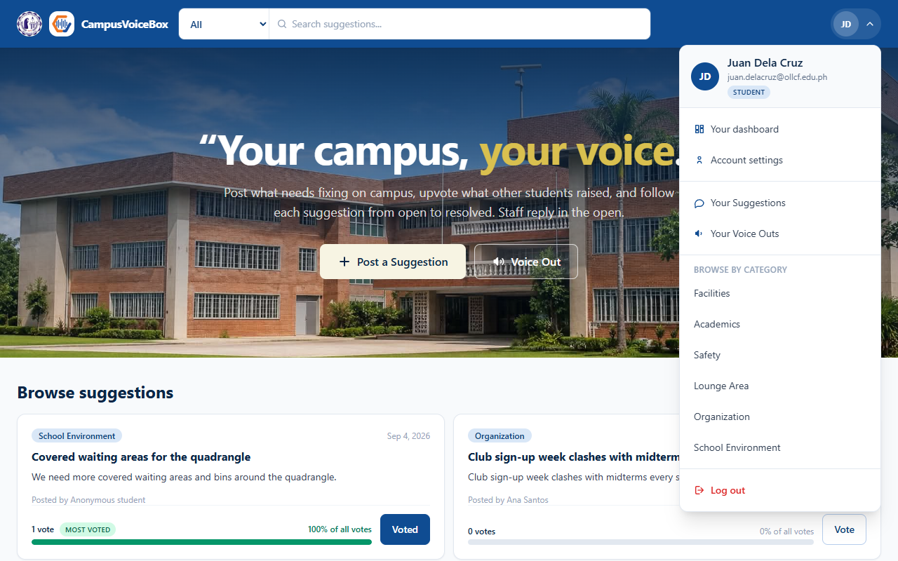

- **Your Suggestions** — your suggestions and requests
- **Your Voice Outs** — your concerns, complaints and reports

Only posts that have been approved appear here, because only those are on the board. Pending and rejected ones are on your dashboard instead.

---

## 6. Your account

Open your profile menu and click **Account settings**.

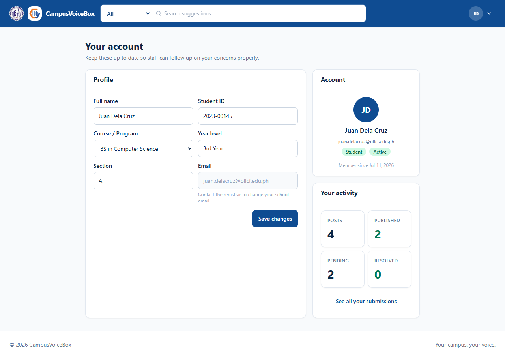

On the left you can edit your **Full name**, **Student ID**, **Course / Program**, **Year level** and **Section**. Click **Save changes**; a green confirmation appears when it has saved. The four school fields are greyed out unless you have allowed CampusVoiceBox to keep them — see [6.1](#61-privacy--data).

Your **Email** is shown but cannot be edited here — it identifies your account. If it needs correcting, ask the registrar or the office that runs CampusVoiceBox.

On the right you can see your role (**Student** or **User**), whether the account is **Active** or **Suspended**, when you joined, and a summary of your activity with a link to your dashboard.

### Your profile photo

Until you add a photo, your profile circle shows your initials. To use a photo instead:

1. Under the circle on the right, click **Upload photo**. On a phone you can pick one from your gallery or take a new one.
2. Choose a JPG, PNG or WebP picture up to 15MB. It saves straight away — you do not need to click **Save changes** — and a green message confirms it.

The photo is cut to a square from its middle, so keep your face near the centre. It replaces your initials in the navigation bar, in your profile menu and on this page. Only you and school staff see it; it never appears on the board beside your posts.

Click **Change photo** to replace it, or **Remove** to go back to your initials.

> **"That photo could not be opened"?** Some iPhone photos (HEIC) cannot be read by every browser. Take a screenshot of the photo, or save it as a JPG, and upload that instead.

> **Keep these details up to date.** When you voice out a concern, the school uses your course to work out which college should handle it, and your year and section to follow up with you.

Your password is changed in the **Password** panel on this page — see [2.6](#26-changing-or-forgetting-your-password).

### 6.1 Privacy & Data

At the bottom of the account page, **Privacy & Data** puts everything about your information in one place:

| Part | What you can do |
|---|---|
| **Policies** | Open the Privacy Policy, Terms & Conditions and Cookie Policy, and see which version of the Terms you accepted. |
| **Your school details** | **Allow keeping my school details** — then fill them in above. **Withdraw and remove my school details** deletes them from your account straight away. |
| **Cookies and browser storage** | See your current choice, and **Manage cookie settings** to change it. Turning the optional category off deletes what it stored. |
| **Download your data** | One click gives you a file (JSON) with everything CampusVoiceBox holds about you: your account, your posts and their files, your votes, notifications, activity and choices. It can contain your photo and attachments — keep it safe. |
| **Make a privacy request** | For what the page cannot do itself: **Access** (for example, the staff notes on your posts), **Correction** (for example, your email), **Account deletion**, or **Other**. An administrator replies here and you get a notification. You can cancel a request until somebody starts on it. |
| **What you have agreed to** | Every acceptance and consent, with its version and the date. |

> **Asking for your account to be deleted.** An administrator reviews the request, then deletes your account. They decide whether your posts are deleted too or kept without your name. Once the account is gone you cannot log in to read the reply — download your data first if you want a copy.

---

## 7. Using CampusVoiceBox on a phone

Everything works on a phone. A few things move to make room:

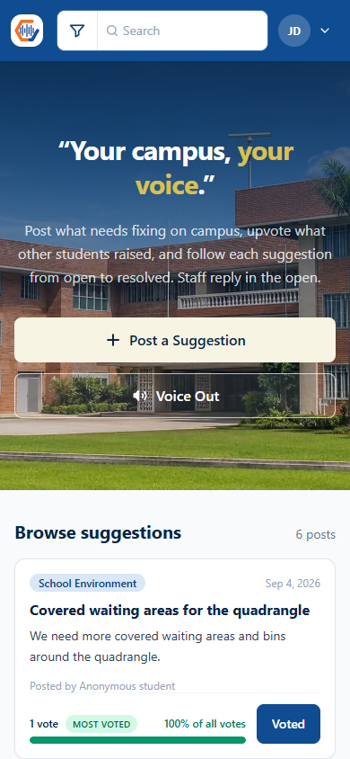

- The navigation bar shows the school seal and the CampusVoiceBox logo without the "CampusVoiceBox" name beside them, and the category dropdown becomes a small icon on the left of the search box.
- On the narrowest phones (under 375px wide), only **Log in** is shown at the top right, to leave room for the search box. To sign up, tap **Log in**, then **Create an account**.
- The board shows one card per row instead of two.
- The posting form slides up from the bottom of the screen.
- Cards on the board fade in as you scroll to them.

---

## 8. Frequently asked questions

**I posted something but it is not on the board.**
That is normal. Every post is reviewed by an administrator first. Check **Your dashboard** — if it says *Pending* or *Under Review*, it is waiting for that decision. If it says *Rejected*, the reason is shown underneath.

**My post was rejected. Can I fix it and resend it?**
Yes. Read the reason on your dashboard, then post a new submission that addresses it. Rejected posts cannot be edited in place.

**Can I edit or delete a post after sending it?**
Not in this version. Re-read your post before pressing the button — and if you need something withdrawn, contact the office that runs CampusVoiceBox.

**Who can see my name if I post anonymously?**
Only administrators, and only inside the admin panel. Your name is never shown on the board, in search results or on another student's screen. Administrators keep it so they can follow up with you and so that the platform is not used to abuse people anonymously.

**The Vote button sends me to the log-in page.**
You need an account to vote. Log in (or sign up) and you will be brought back to the board.

**It says my account is suspended.**
An administrator has suspended your account. If you were already signed in, you can still read the board but posting and voting are turned off; once you log out you will not be able to log back in until it is reactivated. Contact the Student Affairs office.

**I forgot my password.**
Click **Forgot password?** on the log-in page and you will be emailed a link to choose a new one — see [2.6](#26-changing-or-forgetting-your-password).

**The form says my post is "rude" but it isn't.**
The filter blocks a fixed list of offensive words and phrases in English and Filipino. It also sees through the usual disguises — digits and symbols standing in for letters, dots or stars between letters, and accents — so "p0t4ng1na" is caught the same as the plain word. Everyday words that happen to contain a blocked one (like *assignment*) are allowed. Reword the sentence that tripped it; the specific word is deliberately not repeated back to you.

**What are "Request", "Concern", "Complaint" and "Report" for?**
See [4.1](#41-suggestion-or-voice-out-the-five-types). In short: a **Suggestion** is an idea; the other four are things you want the school to *do something about*, and they are handed to a department after approval.

**How long does review take?**
It depends on the office running the platform. Your dashboard's *Awaiting review* counter and each post's status pill are always current.

**Does voting on my own post count?**
Yes, one vote, the same as anyone else's.

**A box asks me to accept the Terms & Conditions.**
The Terms have changed, or your account was made before there were any. You can choose **Not now** and keep reading, but posting and voting stay off until you accept. If your account holds school details from before, a second, optional box asks whether to keep them; leaving it unticked removes them.

**How do I get a copy of my data, or delete my account?**
Under **Privacy & Data** on your account page — see [6.1](#61-privacy--data).

---

*CampusVoiceBox · Our Lady of Lourdes College Foundation · Student Manual*
